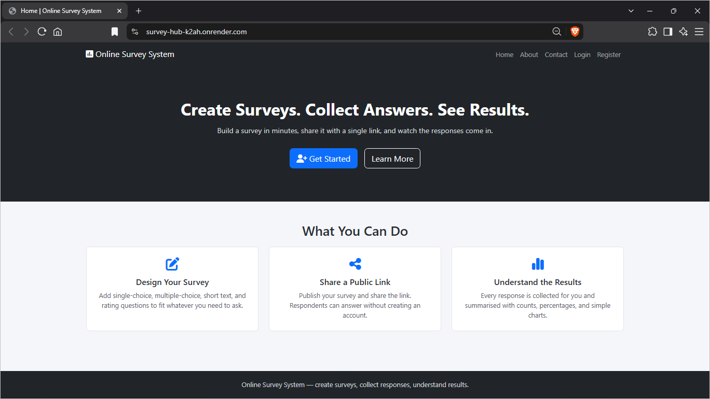
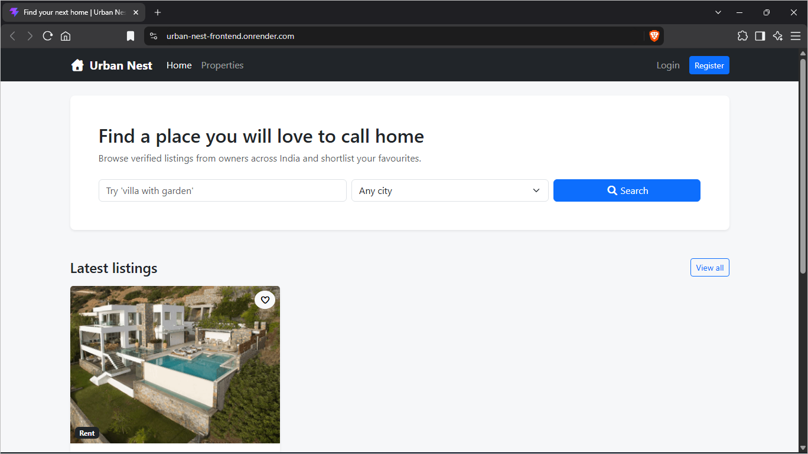
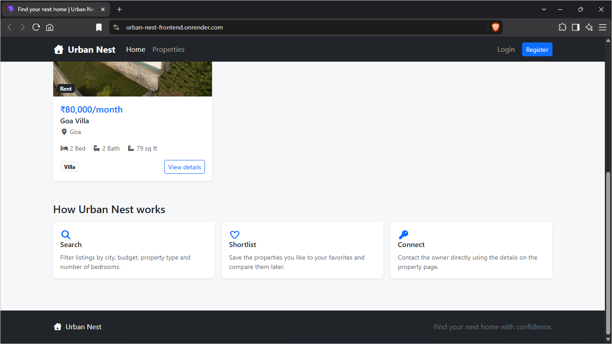
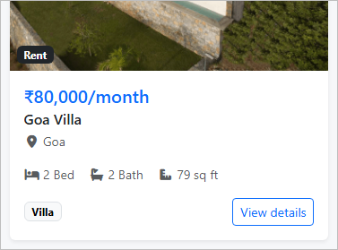

# Design Portfolio

**Survey Hub and Urban Nest**

Prepared by: Kunal Parewa

Course: B.Tech CSE with Big Data Analytics, 4th Year

College: Netaji Subhas University of Technology

---

## 1. Introduction

This portfolio covers two web projects I made: **Survey Hub**, an online survey system, and **Urban Nest**, a property listing website.

Both use Node.js, Express and MongoDB on the backend, but the frontend is built differently. Survey Hub creates its pages on the server with EJS templates. Urban Nest has a separate React frontend that gets its data from an Express API. Making one of each helped me understand how the same kind of backend can be used in two different setups. The screenshots are from the live versions of both sites, hosted on Render.

## 2. Survey Hub

### 2.1 Overview

Survey Hub is a web app for creating surveys and collecting answers. A registered user makes a survey, adds questions and publishes it. Publishing gives the survey its own public link, and anyone with the link can answer without making an account. The owner then sees counts, percentages and charts for every question. (Inside the app, the navbar name is "Online Survey System".)

The main idea was to keep it easy for the people answering, so only the person creating the survey needs an account.

| User | What they can do |
|---|---|
| Respondent | Open a shared link and submit answers. No login needed. |
| Registered user | Create, publish, close or reopen surveys and see results of their own surveys. |
| Admin | See total users, surveys and responses, and delete users or surveys. |

### 2.2 Main Features

- Register, log in and log out, with passwords hashed using bcrypt.
- "My Surveys" dashboard listing only your own surveys with status, question count and date.
- Four question types: single choice, multiple choice, short text and rating (1 to 5). Any question can be required.
- While a survey is a draft, questions can be added, edited, moved up or down and removed.
- Three stages: draft, published and closed. A closed survey can be reopened.
- A unique share link for each published survey, with a Copy button.
- A public answer page and a thank you page.
- Results page with total responses, counts and percentages per option, rating averages, written answers and charts.
- Every form, including submitted answers, is checked on the server.
- Admin area, flash messages, and custom 404 and 500 pages.

### 2.3 Technologies Used

| Part | What I used |
|---|---|
| Server and pages | Node.js, Express 5, EJS with express-ejs-layouts (MVC structure) |
| Styling | Bootstrap 5, Font Awesome, one custom CSS file |
| Database | MongoDB with Mongoose |
| Login | express-session with sessions saved in MongoDB (connect-mongo), bcrypt |
| Validation and charts | Joi, Chart.js (loaded only on the results page) |
| Other | connect-flash, method-override (for PUT and DELETE from forms) |
| Hosting | Render, with MongoDB Atlas for the online database |

### 2.4 Screens

*Figure 1: Survey Hub home page (live version on Render)*

The home page has a dark section with the line "Create Surveys. Collect Answers. See Results." and two buttons: **Get Started** (register) and **Learn More** (About page). Below it, three cards sum up the app: making a survey, sharing a public link and seeing the results. I kept it short on purpose, because most of the app is used after logging in. The navbar changes after login to show Dashboard, the user's name and Logout, plus an Admin link for admins.

Other main pages (no screenshots here):

| Page | What it shows |
|---|---|
| My Surveys (/surveys) | Table of your surveys with status badge, date and view, results, edit and delete buttons. |
| Survey Details (/surveys/:id) | Questions, share link with Copy button, and Publish, Close or Reopen. |
| Add / Edit Question | Question text, answer type, option fields (only for choice questions) and a "required" checkbox. |
| Public Survey (/s/:slug) | Radio buttons, checkboxes, a 1 to 5 rating or a text box depending on the question. |
| Results (/surveys/:id/results) | One card per question with progress bars, percentages and a chart, or the written answers for text questions. |
| Admin (/admin) | Number cards for users, surveys and responses, and tables of all users and surveys. |

### 2.5 How It Works

1. A user registers, logs in and creates a survey. It starts as a **draft**.
2. They add questions. Choice questions need at least two options.
3. They click **Publish** (only allowed with at least one question). The app creates a random link like `/s/3f9a1c7b2e4d`.
4. People open the link and submit answers, which are checked on the server before saving.
5. The owner checks the results page, and can **Close** the survey to stop new answers or reopen it later with the same link.

### 2.6 Design and Implementation Details

**Questions are locked after publishing.** Once a survey leaves draft, question changes are hidden in the page and refused by the routes. This way the collected answers always match the questions that were asked.

**Answers are checked against the survey's own questions.** The Joi rules for the answer form are built from each survey's questions. A choice answer must be one of the options, a rating must be 1 to 5, text is limited to 1000 characters and required questions cannot be empty.

**Data.** There are three collections: users, surveys and responses. Questions are stored inside the survey document, and each response is its own document with the survey id and a list of answers.

**Results are worked out on the server.** `utils/aggregate.js` calculates counts, percentages and averages, and Chart.js only draws them: a pie chart for single choice, bar charts for multiple choice and rating. Percentages are based on how many people answered that question ("3 of 4 answered").

**Other details.** Share links use a random 12 character code from Node's `crypto` module. A middleware checks that a survey belongs to the logged in user, otherwise it says "could not be found". Deleting a survey also deletes its responses. Forms keep what the user typed after an error (except passwords).

**Look and feel.** Dark navbar, hero and footer, a light grey background and white bordered cards, mostly using Bootstrap's default colours. Status badges are grey for draft, green for published and dark for closed. There are no images, only Font Awesome icons.

### 2.7 Problems Faced and Limitations

Two problems only showed up after deploying to Render. First, login kept sending me back to the login page, because the secure cookie was dropped behind Render's proxy. Setting `trust proxy` fixed it. Second, everyone got logged out after each deploy because sessions were kept in memory. I moved them into MongoDB with connect-mongo. I also made a seed script (`npm run seed`) with a sample "Hostel Mess Feedback" survey, which made testing the results page much easier.

Limitations: the same person can answer a survey more than once, ratings are always 1 to 5, results cannot be downloaded (for example as CSV), there is no "forgot password", and the Contact page has placeholder details.

## 3. Urban Nest

### 3.1 Overview

Urban Nest is a property listing website. Owners post flats, houses, villas, plots and other properties for sale or rent. Other users search and filter the listings, look at photos and details, and save the ones they like to favourites. It is made for India, so prices are shown like "₹85 Lakh", "₹1.2 Cr" or "₹80,000/month", and there is a fixed list of ten cities.

I wanted to build a full stack app where the frontend and backend are completely separate, with proper login, real image uploads and checks on who can edit what.

| User | What they can do |
|---|---|
| Visitor | Browse, search and view property details. |
| Registered user | Also save favourites and see the owner's email and phone number. |
| Owner | Also add, edit and delete their own listings, upload photos and change the status. |

On the register page you choose "Browse and save properties" or "List my properties for sale or rent".

### 3.2 Main Features

- Register and login with two roles (user and owner). Phone number is optional (10 digits).
- Search by keyword and filter by city, property type, buy or rent, bedrooms, furnishing and a price slider.
- Sort by newest, price or largest area, with 9 properties per page.
- Property details page with an image gallery and a full screen viewer.
- Favourites with a heart button, and a saved count in the navbar.
- Owner dashboard with total, available and sold/rented counts. Listings can be marked Available, Sold or Rented.
- Up to 6 photos per property (2 MB each), with remove and "Make primary" options.
- Error messages under the exact form field, loading placeholders, empty messages and pop up messages.
- Works on phone, tablet and desktop. On small screens the filters hide behind a "Filters" button.

### 3.3 Technologies Used

| Part | What I used |
|---|---|
| Frontend | React 19 with Vite, React Router, Axios, React Context |
| Styling | Bootstrap 5, Font Awesome, a small custom CSS file, and Material UI for the slider, dialogs, pop ups, pagination, chips and skeletons |
| Backend | Node.js with Express 5 (REST API) |
| Database | MongoDB with Mongoose |
| Login and validation | JWT (jsonwebtoken), bcryptjs, Joi |
| Images | Multer (in memory) and Cloudinary |
| Hosting | Render, with MongoDB Atlas for the online database |

I did not use Redux. Only the logged in user and the saved properties had to be shared between pages, and Context was enough.

### 3.4 Screens

*Figure 2: Urban Nest home page, top part*

The home page starts with a search box: "Find a place you will love to call home". You type a keyword, pick a city and click Search, which opens the Properties page with those filters applied. Below it, "Latest listings" shows the six newest properties. The dark navbar stays at the top while scrolling and shows Favorites, Dashboard (for owners) and Logout after login.

*Figure 3: Urban Nest home page, lower part*

Further down, "How Urban Nest works" explains the site in three steps: Search, Shortlist and Connect.

*Figure 4: Close-up of a property card*

The property card is used on the home, Properties and Favorites pages. It shows the main photo with a Sale or Rent badge, a heart button to save it (see Figure 2), the price in blue, the title, city, bedrooms, bathrooms, area and property type, and a "View details" button. Sold or Rented properties get a yellow badge, and a placeholder image is shown if a photo does not load. The Goa Villa here is only test data I added, so details like 79 sq ft are not real.

Other main pages:

| Page | What it shows |
|---|---|
| Properties (/properties) | Search, sort, filters, removable filter chips, result count, cards and page numbers. |
| Property Details | Photo gallery, details (type, bedrooms, bathrooms, area, furnishing, status), description, price box and a "Listed by" card with contact details. |
| Owner Dashboard | Count boxes and one row per listing with a status dropdown and View, Edit and Delete buttons. |
| Add / Edit Property | The property form, and on the edit page an image section to upload, remove and reorder photos. |

### 3.5 How It Works

**Buyer:** search or open Properties, narrow down with filters, open a property, log in to save it or see the owner's contact details, then contact the owner directly (there is no chat inside the app).

**Owner:** register as an owner, go to Dashboard and click "Add property", fill in the form and click "Create listing". The app then opens the edit page to upload photos. Later the owner can change the status, edit details or delete the listing (after a confirmation).

### 3.6 Design and Implementation Details

**Login with JWT instead of sessions.** The backend sends a signed token with the user id and role. React stores it in localStorage and Axios adds it to every request. On refresh, the app calls `/api/auth/me` to get the user back. I chose tokens because the frontend and backend run on different addresses, and cookies across two domains need a lot of extra setup.

**Three levels of checks for owner actions.** A valid token, an owner role, and then the controller checks that the property belongs to that owner. The React app hides buttons you cannot use, but the real checks are on the backend.

**Images go to Cloudinary.** Free hosting like Render wipes the server's files on restart, so local uploads would disappear. Multer holds the file in memory, the backend sends it to Cloudinary (resized to max 1200px wide) and saves the returned URL and id. The first image is the main photo, so "Make primary" just moves an image to the front. Deleting a property also deletes its images and removes it from favourites.

**Filters are kept in the URL**, for example `/properties?city=Goa&listingType=Rent`, so a search can be bookmarked or shared. The keyword box waits half a second after typing stops before searching. Filtering, sorting and paging all happen in MongoDB. The price slider goes up to ₹5 Cr for sale and ₹2 Lakh per month for rent, and resets when switching between Buy and Rent.

**Favourites update straight away.** The heart changes immediately and the request runs in the background. If it fails, the heart goes back and an error pops up. A unique index on user plus property stops duplicates.

**Look and feel.** Bootstrap for most of the layout, and Material UI only for parts Bootstrap does not have, like the range slider. A light grey background with white cards and soft shadows, blue for buttons and prices, photos cropped to the same 4:3 shape, a slight lift on card hover, and grey placeholder cards while loading.

**How I built it.** Backend first (models, login, properties, search, images, favourites) and tested the API on its own, then the React pages one by one, and finally the mobile layout, loading and error states, and deployment.

### 3.7 Limitations

The home page says "verified listings", but listings are not checked by anyone yet, so an admin approval step would make that true. Other limits: the token in localStorage is less safe than an httpOnly cookie, there is no password reset or in-app messaging, search does not handle spelling mistakes, the city list is fixed, and there are no automated tests (I tested by hand).

## 4. Comparing the Two Projects

| | Survey Hub | Urban Nest |
|---|---|---|
| Pages made | On the server with EJS | In the browser with React |
| Backend | Express app that also sends pages | Express REST API sending JSON |
| Login | Sessions saved in MongoDB | JWT token in localStorage |
| Roles | User, admin | User, owner |
| Main extra part | Chart.js results | Cloudinary image upload |
| Forms | HTML forms, page reloads | React forms, no reload |

Survey Hub was easier to set up because it runs as one app, with no separate frontend and no CORS settings. Urban Nest needed more setup (two apps, CORS, environment variables on both sides and an image service), but moving around it does not reload the whole page. Both ended up with a similar look: dark navbar, light grey background and white cards from Bootstrap.

## 5. What I Learned

- **Server-rendered pages vs React.** With EJS a form submit reloads the page. With React only the data is fetched again.
- **Sessions vs tokens.** Tokens are easier when frontend and backend are on different domains, but have a security trade-off.
- **Always check data on the server**, because hiding a button or adding `required` to an input can be bypassed.
- **Free hosting has its own problems.** The proxy cookie and session issues only appeared after I deployed Survey Hub. For Urban Nest I already knew uploads get wiped, so I used Cloudinary from the start.

## 6. Links

| Project | Live site | Code |
|---|---|---|
| Survey Hub | https://survey-hub-k2ah.onrender.com | https://github.com/kunal5556/Survey-Hub |
| Urban Nest | https://urban-nest-frontend.onrender.com | https://github.com/kunal5556/Urban-Nest |

Both sites are on Render's free plan, so they can take up to a minute to load the first time.
